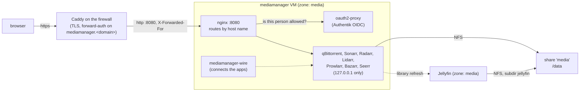

# MediaManager

Primary audience: a household that runs Jellyfin on TAPPaaS and wants new films, series and
music to arrive in its library by themselves.

The media automation stack in one VM: qBittorrent, Sonarr, Radarr, Lidarr, Prowlarr, Bazarr,
Seerr and Unpackerr, connected to each other and to Jellyfin automatically, behind Authentik.

Status: Development. Installed and tested on a TAPPaaS 2.2 site; `test.sh` covers access,
wiring, storage, tiles and the optional VPN.

## What you get

| App | Address | Does | Who |
|-----|---------|------|-----|
| qBittorrent | `https://mediamanager.<domain>` | Downloads into `/data/downloads/<category>` | admins |
| Sonarr | `https://sonarr.<domain>` | Series: finds, downloads, hardlinks into `/data/jellyfin/TV` | admins |
| Radarr | `https://radarr.<domain>` | Films into `/data/jellyfin/Movies` | admins |
| Lidarr | `https://lidarr.<domain>` | Music into `/data/jellyfin/Music` | admins |
| Prowlarr | `https://prowlarr.<domain>` | Indexers, synced to Sonarr, Radarr and Lidarr | admins |
| Bazarr | `https://bazarr.<domain>` | Subtitles for what Sonarr and Radarr import | admins |
| Seerr | `https://seerr.<domain>` | Requests ("I want this series") for the household | users |
| Unpackerr | (no UI) | Extracts packed (RAR) releases so Sonarr, Radarr and Lidarr can import them | — |

*Admins* are members of the Authentik group `mediamanager-admins`, from the site's own
networks only (client and management zones, NetBird). *Users* are members of `users`, from anywhere. One Authentik login covers all
addresses, and each app has a tile in Authentik's app list (group "Media", with the app's own
logo from `icons/`) shown only to the people who may open it. The logos belong to their
projects.

## Design



- **One VM, one door.** Every app listens on `127.0.0.1` only. nginx on port 8080 is the
  only open web port; it picks the app by host name and asks oauth2-proxy, on every request,
  whether the person has an Authentik session and the right group.
- **No logins in the apps.** qBittorrent trusts localhost, the *arr apps run with external
  authentication, Bazarr without; the gate in front of them decides. Seerr keeps its own
  sign-in (with Jellyfin accounts) on top.
- **One mount for downloads and library.** `/data` is the root of the NFS share `media`, so a
  finished download is hardlinked into the library: instant, no extra space, and qBittorrent
  keeps seeding.
- **Its own zone.** mediamanager handles untrusted input (an open torrent port, indexer
  sites, downloaded files), so it belongs in a dedicated zone with Jellyfin, away from the
  site's other services. See [INSTALL.md](INSTALL.md#1-a-dedicated-media-zone-recommended).
- **Connected automatically.** `mediamanager-wire` runs on every install and update; see
  [How the apps are connected](#how-the-apps-are-connected).
- **Kept current.** Each app comes from whichever of the release's nixpkgs and
  nixos-unstable has the newer version, decided at every update; see [Updates](#updates).

## Access

| | Authentik group | From |
|---|---|---|
| Seerr | `users` | anywhere the proxy accepts (home, NetBird, internet) |
| qBittorrent, Sonarr, Radarr, Lidarr, Prowlarr, Bazarr | `mediamanager-admins` | the site's active client and management zones, NetBird and the admin overlay; anything else gets 403 |

- **Authentik decides who.** oauth2-proxy checks an OIDC session from Authentik's
  `mediamanager` app (`identity:identity`) and the group per app. With an Authentik session
  already open this is an automatic redirect, no second login. The session cookie
  (`_mediamanager_auth`) covers all the module's subdomains and lives 4 hours.
- **nginx decides from where.** For the admin UIs it checks the client address Caddy
  reports. Caddy overwrites any `X-Forwarded-For` a client sends, and nginx believes the
  header only from the zone gateway, which is where Caddy connects from. The allowed
  networks are read from `zones.json` on every update.
- **No address is trusted for login.** A NetBird peer that reaches a VM directly arrives
  from the zone gateway too, because the routing peer masquerades; an address alone
  therefore never replaces the Authentik check.
- **Caddy's own gate** (`identity:accessControl`) covers `mediamanager.<domain>`; the
  platform does not put it on extra routes, so the subdomains rely on the gate in the VM.
- **Fail-closed.** Until `identity:identity` has written the OIDC client, oauth2-proxy does
  not start and nothing is served.
- **Admins:** `identity-manager user modify <user> --add-groups mediamanager-admins`.
  The household only needs `users`. `akadmin` is in neither and sees no tiles.

## Choosing apps

Each app is enabled by its entry in `proxyRoutes`. The route list **is** the app selection:
remove `{"name": "lidarr", "port": 8080}` and the next update removes the route, Lidarr, its
tile and its links in Prowlarr. qBittorrent is always there. All routes point at port 8080.

## How the apps are connected

`mediamanager-wire` (`wire.nix`) runs on every install and update; `update.sh` shows its
output. It adds what is missing, corrects what it owns and removes the links of apps that
are no longer enabled:

- Sonarr, Radarr and Lidarr: qBittorrent as download client (categories `tv`, `movies`,
  `music`), the library root folders, hardlinks on.
- Prowlarr: Sonarr, Radarr and Lidarr as applications, so indexers added in Prowlarr reach
  all of them.
- Bazarr: linked to Sonarr and Radarr.
- Seerr: Sonarr and Radarr, once someone has done Seerr's first sign-in.
- Unpackerr: watches the queues of Sonarr, Radarr and Lidarr (configured at build time, runs
  whenever one of them is selected). It extracts a packed release next to the download,
  keeps the archive for seeding and deletes the extracted copy 5 minutes after the import;
  the library keeps its hardlink.
- Jellyfin, when it is installed and mounts the same share: Sonarr, Radarr and Lidarr ask it
  to rescan after every import. This needs a Jellyfin API key, see
  [INSTALL.md](INSTALL.md#first-time-setup).

Left to the operator: indexers in Prowlarr, subtitle languages in Bazarr, Seerr's first
sign-in, Jellyfin's libraries.

## Storage

```
/data/                      the root of the NFS share 'media'
  downloads/  incomplete/  movies/  tv/  music/  audiobooks/    qBittorrent
  jellyfin/   TV/  Movies/  Music/                              the library (Jellyfin: /media)
```

- **Never split `/data` into two mounts.** Separate mounts turn every import into a full
  copy and make hardlinks fail.
- **The share lives where the site wants it:** on a NAS registered with `storage-manager`
  or on a node's pool. The module mounts it by name.
- **Without a share** everything is on the VM's own disk and Jellyfin, in its own VM, cannot
  see it. Declaring the share later moves `/data` into it on the next update.
- **App databases never go on NFS;** they are on the VM disk and in its backup.
- **The apps share the group `media`** with umask 002, so hardlinks also work while `/data`
  is on the VM's disk.

## Updates

Every module update rebuilds the VM. For qBittorrent, Sonarr, Radarr, Lidarr, Prowlarr,
Bazarr, Seerr, Unpackerr, oauth2-proxy and nginx it compares the version in the release's pinned
nixpkgs with the one on nixos-unstable and uses the newer. A security fix therefore arrives
with the next update, whichever channel has it first; once the release catches up, its
package is used again. The rest of the system stays on the release. The build needs GitHub
reachable from tappaas-cicd. If a newer app breaks, the post-update test reports it and the
previous system generation can be restored.

## Optional: VPN for torrents

Off by default; torrents then use the site's WAN address through the `network:nat` port
forward. A site that wants torrent traffic behind a VPN adds one field to its instance
config:

```json
"vpn": { "provider": "proton" }
```

- **Only qBittorrent goes through the VPN.** It runs in its own network namespace whose only
  way out is the WireGuard tunnel. A dropped tunnel means no traffic (kill switch), DNS is
  the provider's, and nscd is hidden from it so lookups cannot go around the tunnel. The
  other apps, the web UIs and Prowlarr's indexer searches use the normal network.
- **Any WireGuard provider works.** Its `.conf` goes in `/etc/secrets/vpn-wireguard.conf` on
  the VM; until it is there, qBittorrent stays stopped. A failed handshake is retried every
  30 seconds.
- **Incoming port**, which seeding needs:

  | `provider` | How |
  |---|---|
  | `proton` | Leased over NAT-PMP every 45 seconds and handed to qBittorrent (P2P server, paid plan) |
  | `airvpn` | The port reserved in AirVPN's client area, as `"forwardedPort": <port>` |
  | `privado` | None. The WireGuard config expires after 30 days; update warns from day 25 |
  | `other` | `forwardedPort` if the provider has one, else no incoming port |

- With the VPN on, the VM closes port 6881; remove `natRules` as well.
- European providers with WireGuard configs: Proton VPN (Switzerland; forwarded ports on paid
  plans, its free plan blocks P2P), AirVPN (Italy; fixed forwarded ports), PrivadoVPN
  (Switzerland; free plan, no forwarded ports). Mullvad has had no forwarded ports since 2023.

## Security

- **Zone:** see Design. Inside a zone there is no firewall between VMs.
- **Sandboxed services:** qBittorrent, Sonarr, Radarr, Lidarr, Bazarr and Unpackerr run with a read-only
  system (`ProtectSystem=strict`), writing only their own data and `/data`, with no
  capabilities, no new privileges and a system-call filter. Prowlarr and Seerr run as
  dynamic users with their own sandboxing.
- **One VM, one trust boundary:** the apps trust each other on localhost and share their API
  keys (`/etc/secrets/arr.env`, 0600). The Jellyfin API key, if set, gives Jellyfin admin
  rights. Prowlarr holds tracker passkeys; they are in the VM backups.
- **Secrets never enter the repository:** API keys are generated on the VM, OIDC credentials
  come from `identity:identity`, the VPN config is copied in by hand.

## Settings that are declarative

qBittorrent's settings and categories are rewritten from `mediamanager.nix` on every start;
changes to them in the WebUI do not survive a restart. The *arr apps keep their own
settings, except bind address, login method and API key.

## What is not included

- Readarr: retired upstream.
- FlareSolverr, for indexers behind Cloudflare challenges.

## Dependencies

| Depends on | Purpose |
|------------|---------|
| `cluster:vm` | The VM, cloned from the NixOS template |
| `backup:vm` | VM backups, including the apps' databases (the share is not part of them) |
| `network:proxy` | `mediamanager.<domain>` and one subdomain per app, all to port 8080 |
| `identity:accessControl` | Authentik forward-auth on `mediamanager.<domain>` |
| `network:nat` | WAN 6881 TCP/UDP to qBittorrent (the zone must list `internet` in `pinhole-allowed-from`) |
| `network:rules` | Firewall paths, including the one to the share |
| `storage:nfs` | The share `media` at `/data` |
| `templates:nixos` | Builds and applies `mediamanager.nix` |
| `identity:identity` | Authentik OIDC app for oauth2-proxy; creates `mediamanager-admins` |

For installation see [INSTALL.md](./INSTALL.md).
